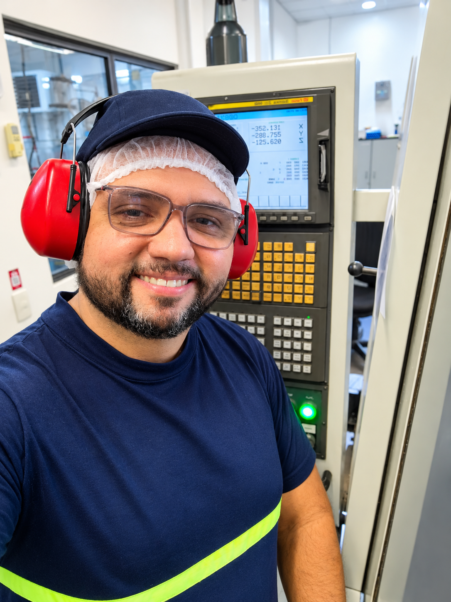
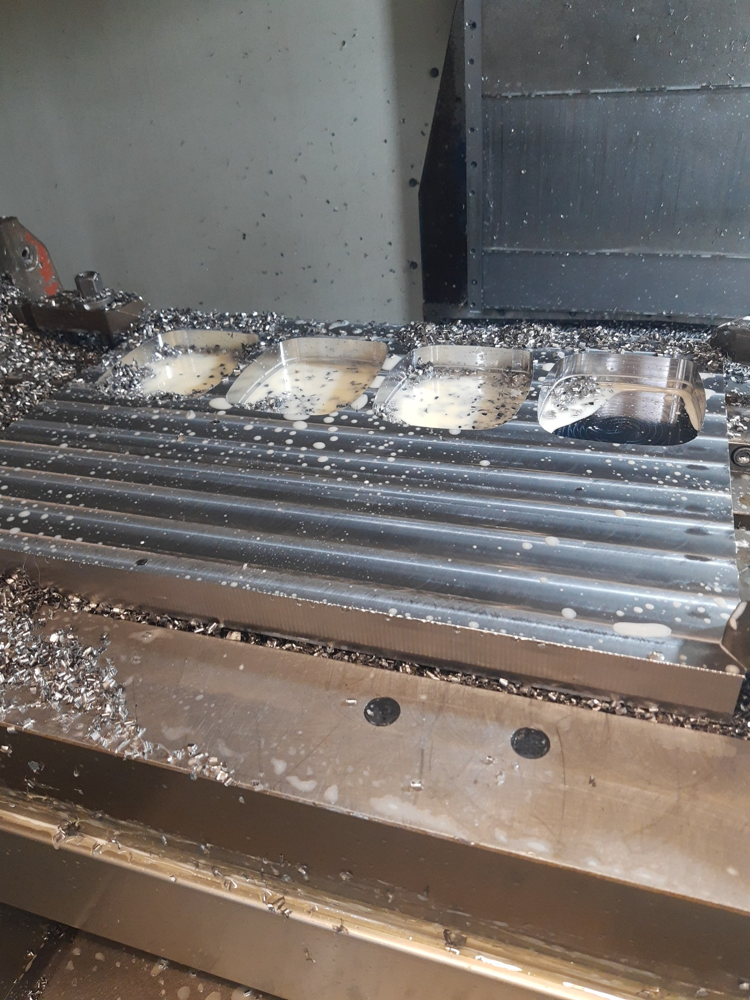

# Hi, I'm Lupércio Silva Marques 👋

**CNC Programmer · CNC Machinist · CAD/CAM Specialist**  
Brazil · Open to international opportunities

With **15+ years of experience** in precision machining, CNC programming, tooling, and mold-related components, I focus on making parts accurately, safely, and reliably—from technical drawing and CAM workflow through machine setup, machining, and inspection.

[LinkedIn](https://www.linkedin.com/in/luperciomarques-cnc) · [GitHub](https://github.com/LupercioMarquescnc)

## What I do

- CNC milling and turning, including 4-axis machining
- CNC programming and G-code
- CAD/CAM programming and toolpath simulation
- Machine setup, operation, and troubleshooting
- Tooling and mold-component manufacturing
- Technical drawings, 3D models, GD&T, and dimensional inspection
- Cutting-tool and machining-process selection
- Process optimization and continuous improvement

## Tools and equipment

**CAD/CAM:** Edgecam · Siemens NX CAM · Mastercam · SolidCAM · Autodesk Fusion 360 · Autodesk Inventor  
**Machines and controls:** Romi · Feeler · FANUC · Siemens

## Selected work

### CNC-machined multi-cavity component

A precision-machined component with multiple cavities, shown during a CNC milling operation. Project details such as material, machining strategy, software, and inspection results can be added as they are confirmed.

## Professional focus

I’m interested in contributing my hands-on machining and programming experience to an international manufacturing or precision-engineering team, while continuing to grow in advanced manufacturing.

---

**Precision · Quality · Engineering · Continuous improvement**
